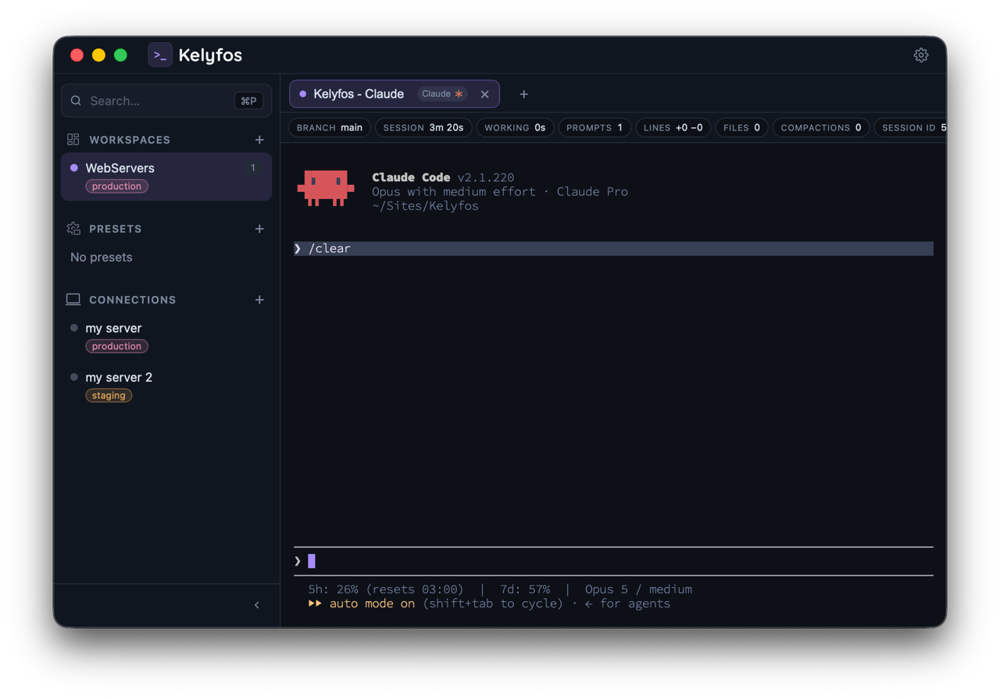
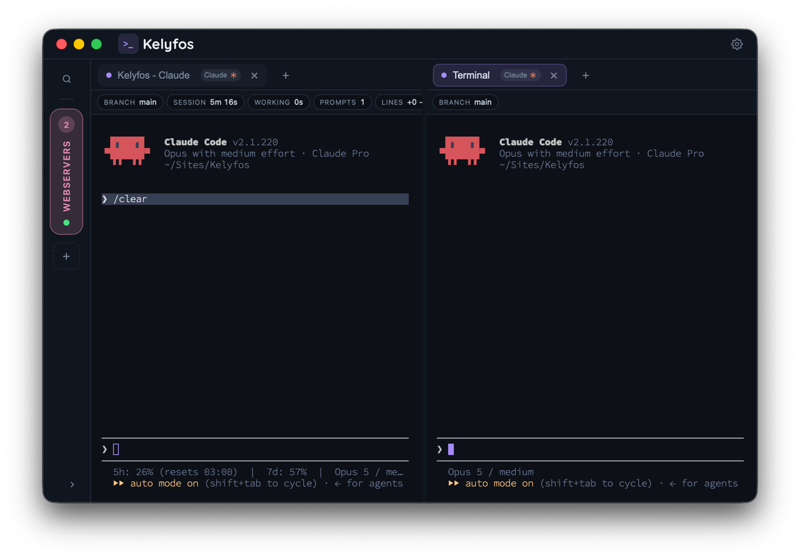
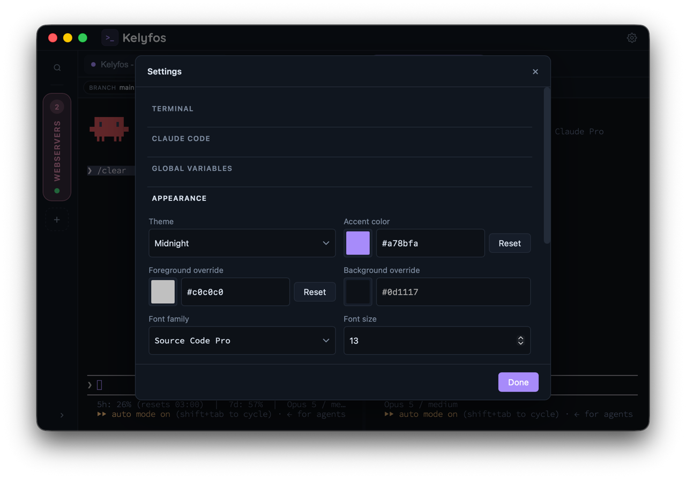

# Kelyfos

A local-first SSH and terminal workspace manager for macOS and Windows. Saved SSH
connections, persistent workspaces, drag-and-drop terminal layouts, and startup
automation. No cloud, no accounts, no telemetry.

Built with **Tauri 2 + Rust**, **React + TypeScript + Zustand**, **xterm.js**,
**FlexLayout**, and **SQLite**.

A connection is a saved `ssh` command line, typed into a real shell — so your
`~/.ssh/config`, ssh-agent and `known_hosts` work exactly as they do in any
terminal.

## Screenshots







## Install

Download the installer for your platform from the
[latest release](https://github.com/aangelov21/kelyfos/releases/latest).

Kelyfos is not code-signed. On macOS, Gatekeeper will refuse the first launch —
right-click the app → **Open**, or allow it under *System Settings → Privacy &
Security*. On Windows, SmartScreen shows **More info → Run anyway**.

The app updates itself from then on: Settings → Advanced → **Check for updates**.

## Development

Prerequisites: Node 20+, Rust (stable), and on Windows the WebView2 runtime.

```sh
npm install
npm run tauri dev              # run the app
npm run tauri build            # produce installers
npm run build                  # frontend only — this is the typecheck
cd src-tauri && cargo test     # Rust tests
```

`CLAUDE.md` describes the architecture: the IPC seam, storage and migrations,
terminal status resolution, and the frontend structure. `docs/PLAN.md` is the
original design document and is partly stale — read it for intent, not as a map.

## Terminal status

Each tab shows a dot for what its terminal is doing. None of it is required for
the terminal itself to work, and precedence between the dots lives in exactly
one place, `src/lib/agentStatus.ts`.

| Dot | Means |
| --- | --- |
| Busy | a command is running |
| Error | the last command exited non-zero — 130 and 143 excluded, since those are your Ctrl-C and SIGTERM |
| Activity | output arrived while you were not looking |
| Claude | a Claude Code run is working, waiting for you, or finished |

A flag clears when you look at the tab, and never appears for something that
happened in front of you: the dot answers "did I miss something", so a chatty
non-zero exit costs one glance rather than the indicator's credibility. Exit
status is the only signal used for the error dot — matching output for words
like "error" was tried and removed, because it fires on a tailed log and on a
build that prints the word while succeeding.

**Shell integration** (on by default, macOS and Linux) has zsh and bash emit
invisible OSC 133 marks, giving exact command start and exit. **Nothing you own
is modified**: zsh is pointed at a generated `ZDOTDIR` whose files source your
own rc files first, and bash gets an `--init-file`. Any other shell runs
unmodified and falls back to watching processes. Toggle it in Settings →
Terminal.

**Windows** has no OSC 133 shell here and no foreground job, so busy is inferred
from the shell's descendants. That is a good answer, not an exact one: work
inside long-lived programs (`claude`, `vim`, `node`, `pwsh`, `cmd`) is not
reported, and a command must last about 0.7 s to register. See
`docs/windows-process-detection.md`.

**Over SSH** the local shell sees one long-running `ssh`, so per-command
statuses arrive only if the *remote* shell emits OSC 133 itself. Otherwise the
session reports one status at the end: `ssh`'s own exit code, or 255 if it
failed to connect.

## Claude Code awareness (optional)

Terminals running Claude are marked automatically by process scan, with no
configuration. That alone separates "Claude is open" from "Claude is working".

Telling *working* from *waiting for you* needs Claude's hooks, which means
writing to `~/.claude/settings.json` — a file this app does not own, so it
happens on a button press in Settings → Claude Code and never on launch.
Connecting backs that file up, adds only Kelyfos entries, and leaves every other
tool's hooks untouched; disconnecting removes exactly those entries. To undo it
by hand, delete any hook whose `command` names `kelyfos/claude-hook.sh` or
`kelyfos/claude-hook.ps1`.

Only the event name, session id and working directory reach Kelyfos — never
conversation content, and none of it enters a backup or an export.

On Windows each event costs about 170 ms, essentially all of it PowerShell
starting, which adds roughly a third of a second per tool call.

## Backups

**Your data:** Settings → Advanced → **Export settings…** writes one JSON file
with every connection, workspace, preset, theme and variable.

**Automatic:** Kelyfos snapshots the database immediately before installing an
update, so a bad release can be undone. The newest 5 are kept in
`<data dir>/kelyfos/backups/`. Snapshots use SQLite's `VACUUM INTO` so each file
is self-contained — copying `app.db` on its own can silently lose everything
still sitting in `app.db-wal`.

The data directory is `~/Library/Application Support/kelyfos` on macOS and
`%APPDATA%\kelyfos` on Windows.

### Restoring a snapshot

There is no restore button — writing over a database the running app holds open
is how people lose data. With Kelyfos **quit**, delete `app.db-wal` and
`app.db-shm` (stale sidecars from the old database will corrupt the restored
one), then put your snapshot in place as `app.db`. Keep the old file until you
have confirmed the restore.

## Schema migrations (maintainers)

`PRAGMA user_version` records which shape the file on disk has.
`src-tauri/src/modules/storage/migrations.rs` holds two halves: **`SCHEMA`**, the
`CREATE TABLE IF NOT EXISTS` batch a fresh install starts from, and
**`MIGRATIONS`**, the ordered steps that are the only path an existing install
takes.

**A new column belongs in both.** `SCHEMA` runs on every launch but can never add
a column to a table that already exists. Miss the migration step and the app's
own reads break: `row_to_*` uses `row.get("col")?`, so one absent column makes
the whole list query return `Err` — an empty sidebar, not a blank field.

Rules:

- **A shipped migration is immutable.** Every user who ran it is already past it
  and will never run it again. Ship a *new* step instead.
- Steps run in version order, each in its own transaction with the version bump
  inside it. A failure rolls back, and the app shows the error and exits rather
  than running against a half-migrated database. Never swallow one with `.ok()`.
- A `VACUUM INTO` backup is taken before the first step and its path goes into
  the error message. An up-to-date database is not snapshotted.
- A database whose version is *above* what the binary knows is refused outright.
- The `SCHEMA` batch runs before the steps, so a step that renames or drops a
  table finds the batch has already recreated the new name, empty.

To add one: put the column in `SCHEMA`, append a `Migration` with the next
version and a `fn(&Transaction)` written defensively (`has_column` before
`ALTER TABLE`), and add a test — there is a `TempDir` helper and a
`seed_baseline` fixture.

`MIGRATIONS` is currently empty and version 0 is the baseline. Three steps
accumulated before the first release and were collapsed into `SCHEMA`, which was
safe only because nothing had shipped and no database recorded having run them.
That window is now closed.

## Updates

Settings → Advanced shows the current version, a **Check for updates** button,
and an off-by-default startup check. The flow is: check → you confirm → database
backup, which must succeed → download → install → restart. If the backup fails
the update is abandoned and nothing is installed.

The app polls one static JSON file, `plugins.updater.endpoints` in
`src-tauri/tauri.conf.json`:

```
https://github.com/aangelov21/kelyfos/releases/latest/download/latest.json
```

`releases/latest` always redirects to the newest **published** release, so the
URL never changes and drafts are invisible to it. The file lists a download URL
and signature per platform, and the bundle is verified against
`plugins.updater.pubkey` before installing — that signature is what makes an
unauthenticated HTTPS download safe.

### Publishing a release (maintainers)

`.github/workflows/release.yml` builds macOS (arm64 + x86_64) and Windows on a
tag push, generates `latest.json`, and uploads everything to a **draft** release.

```sh
# bump "version" in src-tauri/tauri.conf.json, commit, then:
git tag v0.2.0
git push --tags
```

When the jobs finish, open the draft, write the notes, and publish it.
**Publishing is what ships the update** — nothing reaches an installed copy
while the release is still a draft.

Two repository secrets are required (Settings → Secrets and variables →
Actions): `TAURI_SIGNING_PRIVATE_KEY`, the *contents* of `~/.tauri/kelyfos.key`
rather than a path, and `TAURI_SIGNING_PRIVATE_KEY_PASSWORD`.

**Back up the private key and its password.** They are not in this repo and must
never be. Losing either means you can never ship another update to existing
installs, because the matching public key is compiled into every copy already
out there. Rotating the key does the same, so do it only before the first
release — `npx tauri signer generate -w ~/.tauri/kelyfos.key`, then paste the
`.pub` into `plugins.updater.pubkey` and update both secrets.

### Building locally

```sh
export TAURI_SIGNING_PRIVATE_KEY=~/.tauri/kelyfos.key
export TAURI_SIGNING_PRIVATE_KEY_PASSWORD='the key password'
npm run tauri build
```

`TAURI_SIGNING_PRIVATE_KEY`, not `..._KEY_PATH` — Tauri 2 reads only the former,
and accepts either the path or the contents. Getting it wrong does not fail
early: both installers are built first, and only the update signature at the end
reports "a public key has been found, but no private key". The password is not
optional and there is no prompt.

`--no-bundle` skips signing and just produces the executable. A local build
cannot produce a macOS bundle on Windows or a Windows MSI on macOS, which is why
releases go through CI.

## Status

Implemented: connections, workspaces, multi-pane terminal layouts, variables
(global → workspace → terminal), startup tasks, import/export, themes, session
restoration, shell integration, and Claude Code awareness.

Planned (stub in `src-tauri/src/modules/mcp`): MCP server and per-workspace
permissions.

If you fork this, change `identifier` and `plugins.updater.endpoints` in
`src-tauri/tauri.conf.json` and generate your own signing key before releasing.
Otherwise your builds look for updates in this repo and install them: the
public key compiled into them is this repo's, so its releases verify.

## Contributing

Contributions are welcome. See [CONTRIBUTING.md](CONTRIBUTING.md) for how to get
set up, the invariants the code depends on, and the platform gotchas worth
knowing before you build.

## License

[MIT](LICENSE) © Spiros Sklavenitis
